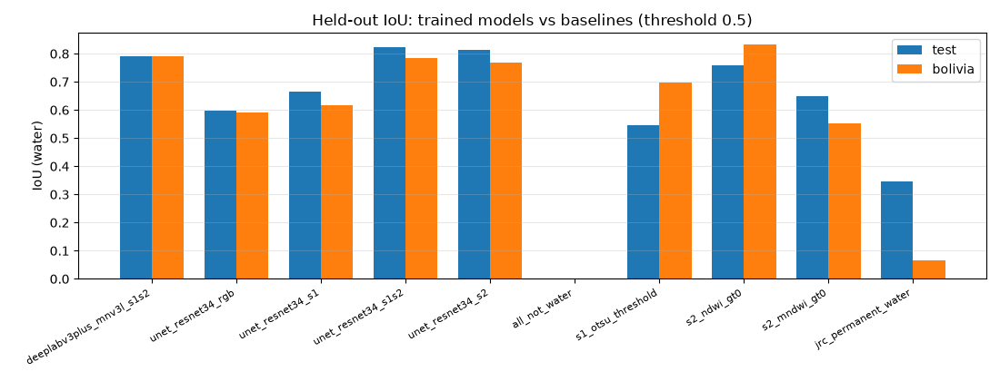
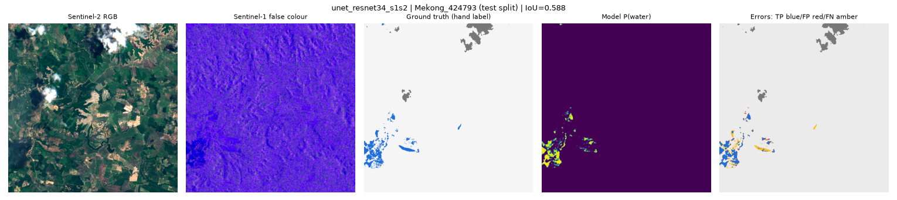

# Real-Time Flood Segmentation and Safe-Route Prediction for Disaster Response

A locally trained deep-learning system that **maps flood water in Sentinel-1/Sentinel-2 satellite imagery** and uses the georeferenced prediction to **compare a shortest route with a flood-risk-aware route on the real OpenStreetMap road network**. It ships with a FastAPI backend and a React dashboard.

> **Research prototype.** Flood extents are model estimates and routes are not verified. Do not use them for real evacuation or navigation decisions; follow official emergency services and verified road-closure information.

## Results at a glance (measured, held-out data)
| | Test split (90 chips) | Bolivia, unseen event (15 chips) |
|---|---|---|
| **U-Net ResNet-34, Sentinel-1+2** (default model) | **IoU 0.823**, F1 0.903 | IoU 0.784, F1 0.879 |
| Best non-learned baseline (NDWI > 0) | IoU 0.758 | **IoU 0.832** |
| Inference, 512×512 chip, RTX 3050 Laptop | 17 ms model-only, ≈46 ms end-to-end | |
| Risk-aware routing (300 OD pairs, scored on hand labels) | **−19.4% labelled-flooded road per trip** for a +4.5% detour (oracle −21.4%) | |

The trained model beats every baseline on the test split, but **not** on the unseen Bolivia event, where a simple water index is better. See the [results](#10-results) and [docs/experimental_results.md](docs/experimental_results.md).

---

## 1. Problem statement
During a flood, responders need to know two things quickly: where the water is, and which roads lead around it. Satellites see water through clouds (Sentinel-1 radar) and in clear skies (Sentinel-2 optical). Turning those images into road-level guidance still requires (a) a reliable segmentation model and (b) a geospatially correct link between that model's pixels and the road network.

## 2. Objectives
1. Train a compact segmentation network on **authentic hand-labelled flood imagery** within a 4 GB laptop GPU.
2. Evaluate it scientifically on held-out data, including an **unseen flood event**, against simple non-learned baselines.
3. Align predictions with **OpenStreetMap roads** using the raster's CRS and geotransform, and score each road segment's flood risk.
4. Plan **baseline and risk-aware routes** (Dijkstra), explain the trade-off, and handle missing data, disconnected networks and "no safe path" cases.
5. Expose everything through a documented API and a polished dashboard that never presents labels or demo data as predictions.

## 3. Key features
* **Segmentation Studio:** drag-and-drop GeoTIFF/PNG/JPEG or held-out Sentinel chips, model selection, threshold, test-time augmentation, an input-versus-prediction slider, probability and mask views, ground-truth comparison for held-out chips, georeferenced water area, latency, and PNG/GeoTIFF export.
* **Safe-Route Planner:** a Leaflet map with Sentinel-2 imagery, the predicted flood layer and risk-coloured OSM roads. Click to set start and destination. Shows baseline, risk-aware and alternative routes with distance, free-flow time, flooded length and an explanation. Adjustable penalties and an optional, clearly labelled closure rule. A "hand label" reference mode is provided for comparison.
* **Model Evaluation:** a comparison table and chart against baselines, training curves, confusion matrix, per-event IoU, sample predictions, latency, checkpoint provenance, and routing evaluation against hand labels.
* **Data & Training monitor:** dataset integrity, split statistics, live GPU telemetry, run progress and ETA, live curves, `train.log`, and a resume command.
* **Reproducible pipeline:** resumable MD5-verified download, preprocessing, resumable training with a PID lock, evaluation, and automated tests.

## 4. System architecture
```
Sentinel GeoTIFF / RGB ─► preprocessing ─► U-Net / DeepLabV3+ (PyTorch, fp16, RTX 3050)
                                              │  P(water) raster + CRS/transform
OpenStreetMap (OSMnx, cached GraphML) ─► road graph ─► edge risk scoring (5 m sampling, CRS-aware)
                                              │
                                     Dijkstra: shortest vs risk-aware vs alternatives
                                              │
                   FastAPI (models loaded once) ◄──► React + Tailwind + Leaflet dashboard
```
Details: [docs/architecture.md](docs/architecture.md).

## 5. Dataset
**Sen1Floods11 v1.1, hand-labelled subset** (Bonafilia et al., 2020): 446 chips of 512×512 px at 10 m resolution in EPSG:4326, from 11 flood events (2016–2019). Each chip has Sentinel-1 VV/VH, Sentinel-2 13-band, a hand label (water / not water / no data), Otsu-threshold labels and JRC permanent water. The official splits are used unchanged: train 252 · valid 89 · test 90 · **Bolivia 15** (an unseen event).

It was downloaded anonymously from `gs://sen1floods11` over HTTPS (1.75 GB, 2,235 files), and **all files passed MD5 verification**. FloodNet and SpaceNet 8 were investigated but not used, for the reasons in [docs/dataset_report.md](docs/dataset_report.md). Data card and licence notes: [docs/data_card.md](docs/data_card.md).

## 6. Preprocessing
* GeoTIFF → one `.npz` per chip (S1 dB, S2 reflectance, 8-bit RGB composite, labels). CRS, transform and bounds are kept in `index.json`.
* Per-band standardisation uses mean/std from the **train split only**. S1 is clipped to [−50, 10] dB. Non-finite values become 0 after standardisation.
* RGB models use a per-image 2–98% stretch plus ImageNet normalisation, identical at training time and for uploaded photos.
* Training samples are 4 random 256² crops per chip per epoch (crops that are > 90% no-data are re-drawn), with flips and 90° rotations. Validation and test use full 512² chips.

## 7. Deep-learning architecture
| Model | Encoder (ImageNet-initialised) | Params | Inputs |
|---|---|---|---|
| U-Net | ResNet-34 | 24.5 M | S1 (2), S2 (13), S1+S2 (15), RGB (3) |
| DeepLabV3+ | MobileNetV3-Large (timm) | 4.7 M | S1+S2 (15) |

Built with `segmentation_models_pytorch` 0.5.0, with a single output logit P(water). For inputs that don't have 3 channels, the pretrained first convolution is adapted by smp. All flood-specific weights were trained locally.

## 8. Training procedure
* Loss: BCE + soft Dice on the water class, both masked to valid pixels (label −1 ignored).
* Optimiser and schedule: AdamW (lr 5e-4, wd 1e-4), 2-epoch linear warmup then per-step cosine decay, gradient clipping at 5.
* Batch 8, fp16 autocast with GradScaler, cuDNN benchmark, seed 42.
* Up to 60 epochs, early stopping after 15 epochs without improvement in validation IoU. The best checkpoint is selected on **validation only**.
* Peak GPU memory was about 0.8–0.9 GiB, so no out-of-memory mitigation was needed.
* Every epoch writes `history.json`, `status.json`, `last.pt`, and `best.pt` when improved. `--resume` restores model, optimiser, scheduler, scaler and the early-stopping counter.

## 9. Evaluation methodology
* Positive class = water. Metrics pool all valid pixels of a split (the Sen1Floods11 "total IoU"): IoU (water, not-water, mean), Dice/F1, precision, recall, pixel accuracy, omission/commission error and the confusion matrix. The mean per-chip IoU is reported too.
* Fixed threshold of 0.5. The test and Bolivia splits are evaluated **once**, after model selection.
* Baselines under the same protocol:
  * a constant "not water" predictor
  * NDWI > 0 (McFeeters, 1996)
  * MNDWI > 0 (Xu, 2006)
  * the Sentinel-1 Otsu labels shipped with the dataset
  * JRC permanent water
* Latency: batch 1, 512², fp16, CUDA-synchronised; the model alone and end-to-end are reported separately.
* Routing evaluation: 300 random OD pairs over 6 held-out areas. Routes are planned on the model prediction and their flooded length is **measured on the hand label**, compared with the shortest route and with an oracle that plans on the label.

## 10. Results
Full tables, confusion matrices, per-event scores and interpretation: **[docs/experimental_results.md](docs/experimental_results.md)**.

| Method | Params | Test IoU | Test F1 | Test precision / recall | Bolivia IoU | Latency |
|---|---|---|---|---|---|---|
| **U-Net ResNet-34, S1+S2** | 24.5 M | **0.823** | **0.903** | 0.941 / 0.868 | 0.784 | 17.1 ms |
| U-Net ResNet-34, S2 | 24.5 M | 0.814 | 0.898 | 0.945 / 0.855 | 0.770 | 16.7 ms |
| DeepLabV3+ MobileNetV3-L, S1+S2 | 4.7 M | 0.792 | 0.884 | 0.916 / 0.854 | 0.790 | 13.0 ms |
| U-Net ResNet-34, S1 (SAR only) | 24.4 M | 0.666 | 0.799 | 0.837 / 0.765 | 0.615 | 14.9 ms |
| U-Net ResNet-34, RGB only | 24.4 M | 0.599 | 0.749 | 0.825 / 0.686 | 0.591 | 14.3 ms |
| Baseline: NDWI > 0 | – | 0.758 | 0.862 | 0.923 / 0.809 | **0.832** | – |
| Baseline: MNDWI > 0 | – | 0.650 | 0.788 | 0.676 / 0.946 | 0.551 | – |
| Baseline: S1 Otsu threshold | – | 0.546 | 0.706 | 0.681 / 0.733 | 0.697 | – |
| Baseline: JRC permanent water | – | 0.345 | 0.513 | 0.954 / 0.351 | 0.065 | – |
| Baseline: constant "not water" | – | 0.000 | – | – / 0.000 | 0.000 | – |

Main model on test: mIoU 0.899, pixel accuracy 0.977, mean chip IoU 0.615. Errors are mostly missed water (FN ≈ 2.4× FP). Training took 15.7 min (46 epochs, early stop, best epoch 31) with a peak of 0.87 GiB of GPU memory.

**Key findings**
* Learned S1+S2 and S2 models beat all baselines on the test split.
* On the unseen Bolivia event, NDWI > 0 beats every network. The models stay precise but miss water under domain shift. This is reported as a negative result.
* Optical bands carry most of the signal: S2 alone is within 0.01 IoU of S1+S2, which is within single-seed noise. SAR alone is weaker but still beats Otsu thresholding on test.
* DeepLabV3+/MobileNetV3 is 5× smaller and loses 3 IoU points on test.





**Routing evaluation:** routes planned on the model prediction and scored against hand labels over 300 random OD pairs in 6 held-out areas. Mean labelled-flooded road per trip fell from 482 m on the shortest route to 389 m on the risk-aware route (oracle 379 m), for a +4.5% mean detour. 3 of 300 pairs got worse. Edge-level flooded/not-flooded agreement with the labels was 84.8–99.8% per area.

## 11. Route-planning algorithm
1. Load the cached OSM drive graph for the raster footprint, or fetch it once through Overpass.
2. Check alignment: reproject road points to the raster CRS (pyproj) and invert the affine transform. Points outside the raster or on no-data pixels count as *unknown*.
3. Sample P(water) every 5 m along each edge's true geometry. An optional max-filter buffer (default 10 m) allows for road width and misregistration.
4. Edge cost = `length + 10·flooded_length + 0.5·length·(1−coverage) + length·mean_P`. All weights are user-adjustable.
5. Run Dijkstra on length (baseline) and on cost (risk-aware). Alternatives come from the penalty method. An optional closure rule (≥ N m flooded ⇒ impassable) falls back explicitly when no path remains.
6. Report distance, free-flow time, flooded and unknown length, max P(water), flood-affected segments, snap distances, and a plain-language explanation with OSM attribution.

## 12. Software requirements
Windows 10/11 · Python 3.13 · NVIDIA driver with CUDA 13 support · Node.js ≥ 20.19 · about 12 GB of disk. Pinned in `backend/requirements.txt` (direct dependencies), `requirements-lock.txt` (full environment) and `frontend/package.json` (exact versions).

## 13. Installation
```powershell
py -3.13 -m venv .venv
.\.venv\Scripts\python -m pip install torch==2.14.1 torchvision==0.29.1 --index-url https://download.pytorch.org/whl/cu130
.\.venv\Scripts\python -m pip install -r backend\requirements.txt
cd frontend; npm ci; cd ..
```

## 14. Dataset setup
```powershell
.\.venv\Scripts\python scripts\download_datasets.py      # resumable, MD5-checked, never overwrites
.\.venv\Scripts\python scripts\verify_datasets.py        # full integrity + structure report
.\.venv\Scripts\python -m training.prepare_data
.\.venv\Scripts\python scripts\fetch_road_networks.py    # OSM graphs for the study areas (cached)
```
Set `FLOOD_DATA_DIR` to put the data elsewhere.

## 15. Training
```powershell
.\.venv\Scripts\python -m training.train --smoke                    # pipeline check
.\.venv\Scripts\python scripts\run_experiments.py                   # all 5 runs + evaluation (skips finished runs)
.\.venv\Scripts\python -m training.train --resume --run unet_resnet34_s1s2
```

## 16. Inference
```powershell
.\.venv\Scripts\python -m training.evaluate --all
.\.venv\Scripts\python -m training.infer --run unet_resnet34_s1s2 --input scene_s1s2.tif --out outputs\cli\scene
.\.venv\Scripts\python scripts\evaluate_routing.py
```

## 17. Starting the application
```powershell
cd frontend; npm run build; cd ..
.\.venv\Scripts\python -m uvicorn backend.app.main:app --host 127.0.0.1 --port 8000
```
Open http://127.0.0.1:8000 for the dashboard and http://127.0.0.1:8000/docs for Swagger. For development, run `npm run dev` in `frontend/` (port 5173, proxies `/api`).

### Demo workflow (about 5 minutes)
1. **Overview:** model readiness, verified dataset, live GPU, held-out IoU against the best baseline.
2. **Segmentation Studio:** select *Spain_7370579* → Run → drag the comparison slider → open "vs. ground truth" to see TP/FP/FN → download the probability GeoTIFF.
3. Upload the same chip as a 15-band GeoTIFF (link under the upload box) to show that real uploads keep their georeferencing, then upload any PNG photo to show the out-of-distribution and no-coordinates warnings.
4. **Route Planner:** *Segura lowlands (A)* → Plan routes. The shortest route crosses about 2.9 km of predicted flooding; the risk-aware route is +387 m and crosses about 0.7 km. Raise the flood penalty, enable the closure rule, then switch to *Hand label (reference)* to compare.
5. **Model Evaluation:** the model against the NDWI/Otsu baselines, the unseen-event (Bolivia) drop, per-event IoU, and the routing evaluation against hand labels.
6. **Data & Training:** MD5 verification, the training history and the resume command.

## 18. Tests
```powershell
.\.venv\Scripts\python -m pytest                 # 41 backend + training tests
cd frontend; npm test                            # unit tests (integration tests need INTEGRATION_API)
$env:INTEGRATION_API="http://127.0.0.1:8000"; npx vitest run   # with the API running
```

## 19. Troubleshooting
See [docs/setup_guide.md](docs/setup_guide.md#troubleshooting). The most common problem is using the system Python instead of `.venv\Scripts\python`.

## 20. Limitations and future work
See [docs/limitations.md](docs/limitations.md). In short:
* the labels mean "water", not specifically "flood"
* 10 m pixels are about the width of a road
* the imagery (2016–19) and the roads (2026) are not contemporaneous
* the test split shares events with training
* single training seed
* routing is confined to each 5 × 5 km raster
* travel times are free-flow

## 21. Citations and acknowledgements
* Bonafilia, D., Tellman, B., Anderson, T., Issenberg, E. (2020). *Sen1Floods11: a georeferenced dataset to train and test deep learning flood algorithms for Sentinel-1.* CVPR Workshops, 210–211. Data from Cloud to Street, `gs://sen1floods11`.
* Contains modified Copernicus Sentinel data (ESA), as distributed in Sen1Floods11.
* Road network © OpenStreetMap contributors, ODbL 1.0. Boeing, G. (2017). OSMnx. *Computers, Environment and Urban Systems* 65, 126–139.
* McFeeters, S. K. (1996). The use of the Normalized Difference Water Index (NDWI) in the delineation of open water features. *Int. J. Remote Sensing* 17(7), 1425–1432.
* Xu, H. (2006). Modification of normalised difference water index (NDWI) to enhance open water features in remotely sensed imagery. *Int. J. Remote Sensing* 27(14), 3025–3033.
* Ronneberger, O., Fischer, P., Brox, T. (2015). U-Net. MICCAI. Chen, L.-C. et al. (2018). DeepLabV3+. ECCV. Howard, A. et al. (2019). MobileNetV3. ICCV. He, K. et al. (2016). ResNet. CVPR.
* Software: PyTorch, segmentation_models_pytorch, timm, rasterio, pyproj, shapely, OSMnx, NetworkX, FastAPI, React, Vite, Tailwind CSS, Leaflet, Recharts.
